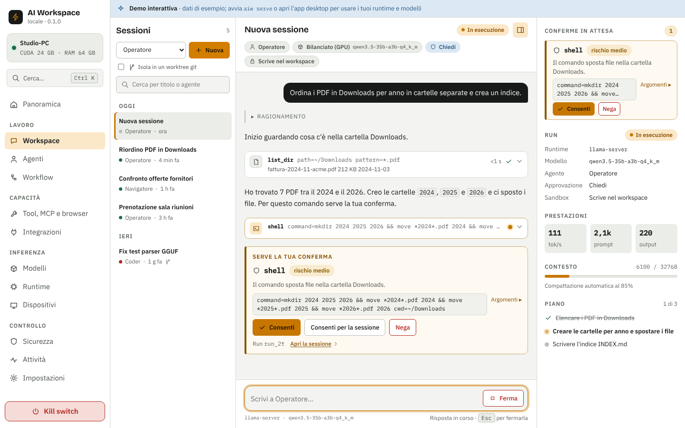

# AI Workspace Local

Workspace AI **locale** e multipiattaforma (Windows, macOS, Linux, Android, iOS) che riunisce sotto
un'unica API **tutti i metodi di inferenza on-device**: llama.cpp, Ollama, LM Studio, vLLM, SGLang,
TensorRT-LLM, MLX, Foundry Local, Windows ML, LiteRT-LM, Gemini Nano, Apple Foundation Models,
ExecuTorch, MLC e altri. Sopra ci sono layer agentici per i **task operativi**, non solo per il
coding: file, shell in sandbox, browser via CDP, computer-use, MCP e workflow schedulati con
conferme umane.



## Documenti

| | |
|---|---|
| Reverse engineering (REA) degli agenti di frontiera | [docs/research/01-reverse-engineering.md](docs/research/01-reverse-engineering.md) |
| Panorama runtime, modelli e protocolli (nov 2026) | [docs/research/02-frontier-landscape.md](docs/research/02-frontier-landscape.md) |
| Stato dell'app per layer, limiti noti e come procedere (v0.4) | [docs/STATUS.md](docs/STATUS.md) |
| Architettura e ADR | [docs/architecture/ARCHITECTURE.md](docs/architecture/ARCHITECTURE.md) |
| Model hub multi-provider: contratto API e provider | [docs/architecture/model-hub.md](docs/architecture/model-hub.md) |
| Design system e flussi | [docs/design/DESIGN.md](docs/design/DESIGN.md) |
| Architettura della UI: struttura, router, data layer, design system | [docs/design/UI-ARCHITECTURE.md](docs/design/UI-ARCHITECTURE.md) |
| Parlare con l'assistente da Telegram, Slack e email: guida all'attivazione e alla sicurezza | [docs/channels.md](docs/channels.md) |
| Mockup interattivo (file unico, si apre offline) | [docs/design/mockup/index.html](docs/design/mockup/index.html) |
| Contribuire: prerequisiti, prove, convenzioni | [CONTRIBUTING.md](CONTRIBUTING.md) |
| Come si fa una release (tag, lavori di CI, arm64 e CUDA, canali) | [docs/release/RELEASE.md](docs/release/RELEASE.md) |

## Struttura

```
crates/
  aiw-core       tipi API, eventi AG-UI 1.0, schemi delle impostazioni, configurazione a strati
  aiw-hw         probe hardware: CPU, RAM, CUDA/ROCm/Metal/Vulkan/DirectML, NPU → classe del device
  aiw-runtimes   33 manifest di runtime, rilevamento, adapter OpenAI/Ollama/nativo, supervisor dei sidecar, client di trascrizione (whisper.cpp e API OpenAI), fallback a catena tra backend
  aiw-models     model hub multi-provider (Hugging Face, ModelScope, registry Ollama, URL diretto), parser GGUF, compatibilità per device (anche i modelli Whisper), download con ripresa
  aiw-tools      file, ricerca, shell (bwrap/sandbox-exec), web_fetch anti-SSRF, web_search, browser CDP, computer-use, client MCP
  aiw-agent      loop agentico: streaming, tool paralleli, policy, hook, skill, subagenti, compattazione
  aiw-workflow   workflow YAML/JSON: tool/agent/llm/approval/condition, trigger cron/intervallo/file
  aiw-engine     facciata unica: SQLite, sessioni, run, approvazioni, audit, kill switch, gateway, voice mode (anche la voce neurale), router automatico dei runtime
  aiw-server     REST + SSE (AG-UI), gateway OpenAI /v1, pairing LAN, UI statica
  aiw-winsandbox sandbox Windows: integrità bassa e job object (usata da aiw-tools)
  aiw-cli        `aiw`: serve, doctor, runtimes, models, profile, run, workflow
apps/
  ui             UI React unica per desktop, mobile e browser (transport Tauri/HTTP/mock)
  desktop        shell Tauri 2 (desktop + mobile) e plugin nativo Swift/Kotlin per i modelli di sistema
```

## Avvio rapido

Prerequisiti: Rust 1.85+, Node 22+. Per usare un modello locale serve almeno un runtime:
`llama-server` di llama.cpp nel `PATH` (oppure Ollama, LM Studio…).

```bash
cargo build --release -p aiw-cli
```

```bash
./target/release/aiw doctor
```

```bash
./target/release/aiw models pull qwen3-1.7b
```

Altri provider del model hub (`aiw models search|show|pull|rm|providers`):

```bash
./target/release/aiw models providers
./target/release/aiw models search qwen --provider hf --format gguf --sort downloads --limit 10
./target/release/aiw models show hf Qwen/Qwen3-4B-GGUF
./target/release/aiw models pull --provider hf --model Qwen/Qwen3-4B-GGUF --variant Q4_K_M
./target/release/aiw models pull --url https://example.com/modello.gguf
```

```bash
./target/release/aiw profile --runtime llama-server --model qwen3-1.7b-q8_0 --context 8192
```

```bash
./target/release/aiw run "Crea il file note.md con un riepilogo della cartella" --agent operator
```

Interfaccia web servita dal daemon (anche dal telefono, dopo il pairing):

```bash
npm ci --prefix apps/ui && npm run build --prefix apps/ui
```

```bash
./target/release/aiw serve --ui apps/ui/dist
```

App desktop (Tauri 2; su Linux servono `libwebkit2gtk-4.1-dev` e simili):

```bash
npm ci --prefix apps/desktop && npm run dev --prefix apps/desktop
```

Mobile: `npm run android:init` / `npm run ios:init` in `apps/desktop`, poi `android:dev` / `ios:dev`.

### Gateway e protocolli

`http://127.0.0.1:7777` espone i modelli locali e gli agenti a qualsiasi client. Dalla LAN serve un
token: ogni dispositivo ne riceve uno suo con il codice di pairing a 6 cifre, e per un'altra app si crea
un token a parte (vedi sotto).

#### Un token per un'altra app

Una app di terzi (un editor, uno script, un SDK OpenAI o Anthropic) non deve usare il token di questo
computer: ne ottiene uno suo, che apre solo `/v1/*`, si può far scadere e si revoca da solo.

```bash
./target/release/aiw tokens create "Il mio editor" --expires-in-days 90   # il valore si vede una volta sola
export OPENAI_BASE_URL=http://127.0.0.1:7777/v1
export OPENAI_API_KEY=aiw_…                                               # il token appena creato
./target/release/aiw tokens list
./target/release/aiw tokens revoke tok_…      # smette di funzionare subito
./target/release/aiw tokens rotate tok_…      # ne mette uno nuovo al suo posto
```

Lo stesso si fa dall'app in Sicurezza → Accessi (modalità Sviluppatore: «Nuovo token per un'app»); lì i
dispositivi accoppiati hanno «Scollega». Con `--scope mcp` e `--scope a2a` il token apre anche `/mcp` e `/a2a`.

#### Cifrare la rete (TLS)

Con `--lan` il traffico è HTTP in chiaro: chi è sulla stessa rete può leggere codice di pairing, token e
conversazioni. Per cifrarlo imposta `server.tls` (Impostazioni, o Sicurezza → Rete) e riavvia `aiw serve`:

- `self_signed`: AIW crea un'autorità locale e un certificato per il nome del computer, `localhost` e
  gli indirizzi di rete (si rinnova da solo se gli indirizzi cambiano). L'impronta SHA-256 dell'autorità è nel
  QR di pairing: un altro AIW la «fissa» e da allora si fida solo di quel certificato.
- `files`: il tuo certificato (`server.tls.cert_file`, `server.tls.key_file`, file PEM).

Un **browser** su un altro dispositivo non può fissare un certificato: mostrerà un avviso finché non
installi l'autorità (`GET /api/tls/ca.pem`, o «Scarica il certificato» in Sicurezza → Rete) e confronti
l'impronta. Con TLS attivo il listener rifiuta l'HTTP in chiaro dalla rete (da questo computer resta
accessibile `http://127.0.0.1:<porta>`).

| Endpoint | Per cosa |
|---|---|
| `/v1/chat/completions`, `/v1/models` | Client OpenAI-compatibili (editor, SDK, CopilotKit, agenti CLI `--oss`) |
| `/v1/messages` | Client Anthropic Messages, streaming e tool compresi |
| `/v1/audio/transcriptions` | Trascrizione (multipart OpenAI) con il whisper di questo dispositivo |
| `/v1/audio/speech` | Sintesi vocale (JSON OpenAI, risposta WAV) con la voce neurale di questo dispositivo |
| `/mcp` | Server MCP: strumenti e agenti locali per altre app o dispositivi |
| `/a2a`, `/.well-known/agent-card.json` | A2A 1.0 (JSON-RPC, anche in streaming SSE): altri agenti affidano task a quelli locali |
| `/hooks/{id}` | Trigger webhook dei workflow (segreto o firma HMAC-SHA256 stile GitHub) |

### Voce

Serve un motore di trascrizione: `whisper-server` di whisper.cpp (su macOS `brew install whisper-cpp`)
più un modello Whisper, oppure LocalAI, oppure un dispositivo accoppiato che ce l'ha.

```bash
./target/release/aiw models pull whisper-small-q8
```

Nella chat il microfono detta il messaggio; l'icona accanto avvia la conversazione a voce: parli,
l'agente lavora e risponde con la voce neurale (se c'è) o con una voce locale del sistema, poi torna
in ascolto. Ogni risposta ha il pulsante «Leggi ad alta voce»; Esc ferma la lettura. Nel browser il
microfono richiede `localhost` o HTTPS.

#### Voce neurale (Piper, Kokoro)

Di serie le risposte si leggono con le voci del sistema. Per una voce migliore, in Impostazioni → Voce
(`voice.tts.engine`, di serie `auto`: Piper se è installato con una voce nella lingua della risposta, poi
il server della voce se è indicato, altrimenti il sistema):

- **Piper** (locale, CPU). Scarica la release di Piper da <https://github.com/rhasspy/piper/releases>,
  estraila e metti la cartella nel `PATH` (o nella cartella dei runtime di AIW, o indica il percorso nel
  runtime «Piper»). Poi scarica una voce da Modelli («Voce Paola» per l'italiano, «Voce Lessac» per
  l'inglese) oppure mettine una (`xx_XX-nome-qualità.onnx` con il suo `.onnx.json`) nella cartella dei modelli.
  Piper parte una volta per frase.
- **Kokoro** tramite un server compatibile OpenAI. Con [Kokoro-FastAPI](https://github.com/remsky/Kokoro-FastAPI):
  `docker run -p 8880:8880 ghcr.io/remsky/kokoro-fastapi-cpu:latest` (per la GPU NVIDIA l'immagine
  `kokoro-fastapi-gpu` con `--gpus all`). In Impostazioni → Voce indica «Server della voce»
  `http://localhost:8880` e il modello `kokoro`; le voci italiane di Kokoro sono `if_sara` e `im_nicola`.
  Va bene anche LocalAI o qualunque server con `POST /v1/audio/speech`. **Il testo da leggere viene inviato
  a quel server**: usa solo server di cui ti fidi.

«Prova» accanto alla voce di una lingua legge una frase di esempio. Piper e Kokoro non sono mai stati
provati dall'ambiente di sviluppo (solo un eseguibile e un server finti nei test) e le dimensioni delle voci
nel catalogo sono indicative.

#### Runtime automatico

Nel profilo, «Runtime: Automatico» (vista Sviluppatore) lascia scegliere ad AIW il runtime migliore per il
modello su questo dispositivo, con i motivi e le alternative; se quello scelto non parte, il run continua
sul successivo (al massimo due cambi, mai a metà risposta) e la chat lo dice in una nota.

### Rete di dispositivi

```bash
./target/release/aiw serve --lan --ui apps/ui/dist
```

In Dispositivi compaiono gli altri AI Workspace trovati via mDNS e il QR: il telefono lo inquadra e
apre l'interfaccia già accoppiata. Un dispositivo accoppiato presta i suoi modelli (runtime
`aiw-peer`), i suoi strumenti e agenti (server MCP) e la sua trascrizione.

## Sicurezza

AIW gira sul tuo computer e ascolta solo su `127.0.0.1` finché non attivi l'accesso dalla LAN. I comandi della shell girano in una sandbox
dove la rete è **chiusa di default** (Sicurezza → Sandbox per accenderla), la cartella dei dati di AIW e le cartelle di credenziali
(`~/.ssh`, `~/.aws`, …) sono nascoste e le variabili d'ambiente che sembrano segreti non arrivano ai comandi. Il compromesso: `git` via SSH non
trova la tua chiave; per consentirlo togli `~/.ssh` da «Cartelle nascoste» (o usa HTTPS con un token). Su **Windows** la rete dei comandi non si
può chiudere e le cartelle non si possono nascondere in lettura; su macOS il profilo non è mai stato provato su un Mac. I server MCP stdio possono
essere isolati (non su Windows) e chiedono conferma al primo avvio di un comando nuovo o cambiato. Modello di minaccia, limiti noti e come segnalare
una vulnerabilità in privato: [SECURITY.md](SECURITY.md).

## Stato (v0.4)

Dettagli, limiti noti e prossimi passi in [docs/STATUS.md](docs/STATUS.md).

| Area | Stato |
|---|---|
| Core Rust (11 crate) | Implementato; 357 test |
| Inferenza | 33 manifest; sidecar OpenAI-compatibili, Ollama, llama.cpp e ONNX Runtime GenAI in-process; 6 runtime solo manifest |
| Modelli | Model hub: Hugging Face, ModelScope, registry Ollama, URL diretto; download con ripresa e sha256 |
| Allegati | Immagini e file nella chat (graffetta, trascinamento, incolla): testo e PDF con testo letti dal modello, immagini ai modelli con visione |
| Documenti | Raccolte di file locali (testo, Markdown, codice, PDF con testo) che l'assistente cerca per parole chiave e, con un modello di embedding avviato, per significato; pagina «Documenti», `aiw kb` e gateway `/v1/embeddings` |
| Canali e posta | Parla con l'assistente da Telegram, Slack o email (spenti di serie, solo mittenti in elenco, di serie in sola lettura); posta IMAP in sola lettura per il riepilogo e gli strumenti; pagina «Canali», `aiw channels`, guida in [docs/channels.md](docs/channels.md). Mai provato contro i servizi veri |
| Voce | Trascrizione con whisper.cpp o con server OpenAI-compatibili (LocalAI, Nexa, dispositivo accoppiato); dettatura e conversazione a voce nella chat con le voci locali del sistema |
| Policy e sandbox | Cinque modalità, regole che leggono ogni comando di una riga composta, audit, kill switch; shell con rete chiusa di default e cartelle di credenziali nascoste (bwrap su Linux; sandbox-exec su macOS, mai provato su un Mac; su Windows integrità bassa + job object, **senza** rete chiusa né letture nascoste); server MCP stdio isolabili (non su Windows) e da approvare al primo avvio. Vedi [SECURITY.md](SECURITY.md) |
| Tool | File, shell, `web_fetch` anti-SSRF, `web_search` (SearXNG, Brave, DuckDuckGo), browser CDP, computer-use, client MCP |
| Agenti e workflow | Loop con subagenti, hook, skill; workflow con trigger manuale, cron, intervallo, file, webhook |
| API | REST + SSE, gateway OpenAI e Anthropic, server MCP, A2A; token, CORS ristretto, controllo di Origin/Host |
| UI | React unica per desktop, mobile e web; 629 test Vitest e smoke test Playwright (29 rotte, 2 larghezze, 2 temi) |
| Lingue | Interfaccia in italiano e inglese (`ui.language`: automatica, `it`, `en`); la traduzione inglese è parziale, vedi `docs/STATUS.md` §3 |
| Piattaforme | Tauri su Windows, macOS, Linux, Android; iOS: app per simulatore (senza firma), costruita in CI |
| Non verificato | Build GPU (CUDA, Vulkan), percorsi nativi Apple e Android su hardware reale, provider contro i servizi reali |

Il reverse engineering usa solo artefatti pubblici e scaricabili e ne estrae idee e architettura
(metodo clean-room descritto nel documento di ricerca): nessun codice proprietario è copiato.

## Crediti dei font

I font dell'interfaccia sono inclusi nell'app e distribuiti con licenza SIL Open Font License 1.1: Bricolage Grotesque, IBM Plex Sans e IBM Plex Mono. Testi delle licenze in `licenses/`.
