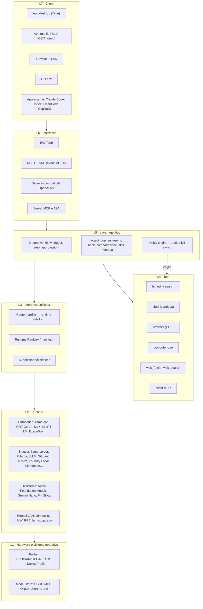
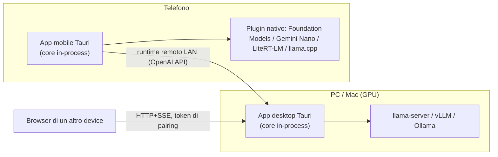
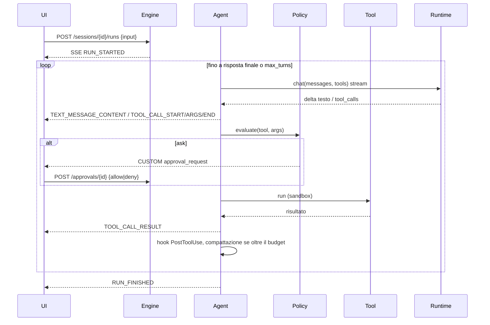

# Architettura · AI Workspace Local (AIW)

> Versione 0.1 · 2026-11-01 · Input: [ricerca REA](../research/01-reverse-engineering.md) (pattern P01–P24) e [panorama di frontiera](../research/02-frontier-landscape.md)

## 1. Obiettivi e vincoli

1. **Locale prima di tutto**: tutto funziona offline. Il cloud non serve e non si contatta mai
   senza un consenso esplicito.
2. **Ovunque**: Windows, macOS, Linux, Android, iOS (e browser come client remoto) con lo stesso
   core e la stessa UI.
3. **Tutti i metodi di inferenza**: embedded, sidecar, modelli di sistema, endpoint LAN, sotto
   un'unica API.
4. **Ogni layer personalizzabile dall'app**: ogni componente (runtime, modello, tool, agente,
   workflow, policy) è descritto da un *manifest* con uno *schema di impostazioni*; la UI genera i
   form dagli schemi e la configurazione è a strati, con override ispezionabili.
5. **Agentico oltre il coding**: file, shell, browser, computer-use, MCP, workflow schedulati, subagenti.
6. **Sicuro di default**: policy esplicita, sandbox del sistema operativo, audit trail e kill switch.

## 2. Vista a layer



| Layer | Crate / package | Responsabilità | Pattern |
|---|---|---|---|
| L1 | `aiw-hw`, `aiw-models` | Rilevamento hardware, catalogo e store dei modelli, parser GGUF, download con ripresa | — |
| L2–L3 | `aiw-runtimes` | Manifest dei runtime, rilevamento disponibilità, adapter, supervisor, router | P20 |
| L4 | `aiw-tools` | Tool builtin, client MCP, browser CDP, computer-use | P12, P14, P18, P19 |
| L5 | `aiw-agent`, `aiw-workflow` | Loop agentico, policy, hook, contesto, skill, subagenti, workflow | P04–P11, P13, P15, P17, P22 |
| L6 | `aiw-server`, `apps/desktop/src-tauri` | API HTTP/SSE, gateway OpenAI, IPC | P01–P03 |
| L7 | `apps/ui`, `aiw-cli` | UI React unica (desktop, mobile, web) e CLI | — |
| Collante | `aiw-core`, `aiw-engine` | Tipi, configurazione a strati, eventi AG-UI, storage; facciata `Workspace` | — |

## 3. Topologie di deployment



- **Standalone**: il core gira dentro l'app (desktop o mobile).
- **Daemon**: `aiw serve` su un PC o server headless; i client si collegano via HTTP.
- **Mesh**: i device si accoppiano. Il telefono usa i modelli grandi del PC come runtime `remote`
  e il PC delega al telefono i task che servono lì (A2A 1.0 e server MCP del peer).

## 4. Inferenza unificata (L2–L3)

### 4.1 Runtime manifest

Ogni runtime è un file JSON dichiarativo (vedi `crates/aiw-runtimes/manifests/`):

```jsonc
{
  "id": "llama-server",
  "name": "llama.cpp server",
  "kind": "sidecar",                 // embedded | sidecar | system | remote
  "platforms": ["windows","macos","linux"],
  "accelerators": ["cpu","cuda","metal","vulkan","rocm","sycl"],
  "formats": ["gguf"],
  "api": "openai",                   // openai | ollama | native
  "capabilities": ["chat","tools","vision","embeddings","grammar"],
  "detect": { "binaries": ["llama-server"] },
  "launch": {
    "command": "llama-server",
    "args": ["-m","{model_path}","--host","127.0.0.1","--port","{port}","-c","{ctx_size}","-ngl","{gpu_layers}","--jinja"],
    "health": "/health",
    "ready_timeout_s": 120
  },
  "settings": {                      // JSON Schema (sottoinsieme) → form generato nella UI
    "type": "object",
    "properties": {
      "ctx_size":   { "type": "integer", "default": 8192, "minimum": 512, "title": "Context" },
      "gpu_layers": { "type": "integer", "default": 999, "title": "GPU layers" },
      "extra_args": { "type": "array", "items": {"type": "string"}, "title": "Argomenti extra" }
    }
  },
  "install": { "hint": "winget install llama.cpp | brew install llama.cpp | nix/apt" }
}
```

- **Rilevamento**: binari nel `PATH` o in percorsi noti, endpoint raggiungibile, piattaforma
  compatibile, bridge nativo registrato. Lo stato è uno di `available`, `installable`, `running`,
  `unsupported`.
- **Adapter**: `openai` copre la maggior parte dei sidecar (llama-server, vLLM, SGLang, mlx-lm,
  TRT-LLM, Foundry Local, Lemonade, LM Studio, LocalAI…); `ollama` usa lo stesso adapter OpenAI e vi aggiunge solo la
  parte nativa minima (elenco dei modelli **installati** da `GET /api/tags`; `num_ctx` e
  `keep_alive` non passano da `/v1`, quindi vanno nell'ambiente di `ollama serve`:
  `OLLAMA_CONTEXT_LENGTH` e `OLLAMA_KEEP_ALIVE`); `native` instrada verso un *bridge* fornito dalla
  shell (plugin Swift o Kotlin, embedded FFI).
- **Supervisor**: avvia il processo, assegna la porta, sostituisce i placeholder (`{model_path}`,
  `{model}`, `{model_id}`, `{port}`, impostazioni), attende l'health check, raccoglie i log,
  riavvia secondo la policy e ferma tutto all'uscita. `{model}` è il percorso locale (file o
  cartella) quando il modello del profilo è un modello locale, altrimenti l'id così com'è (repo
  Hugging Face che il runtime scarica da solo); `{model_id}` è sempre l'id. Le variabili `env`
  senza valore non vengono esportate.
- **Contesto del profilo**: la finestra di contesto del profilo (`InferenceParams.context`) ha la
  precedenza sul setting di contesto del runtime (`ctx_size`, `max_model_len`, oppure il setting
  indicato da `launch.ctx_setting`) per il processo avviato per quel profilo, e per le generazioni
  di un motore in-process. Un sidecar già avviato da AIW con un contesto più piccolo viene
  riavviato; uno più grande viene riusato. Un server avviato fuori da AIW non si modifica.
- **Architettura**: `arch` (opzionale, es. `["aarch64"]`) limita un runtime a una CPU oltre che al
  sistema operativo: MLX e Apple Foundation Models non sono offerti su un Mac Intel.
- **Installazione automatica**: un manifest può avere un campo `installer` per OS
  (`{"macos": {"kind": "pip", "packages": ["mlx-lm"]}}` oppure `{"kind": "brew", "formula": "llama.cpp"}`).
  Un clic nella UI installa il runtime senza altre domande: i pacchetti `pip` vanno in un ambiente Python
  isolato di AIW (`~/.aiw/pyenv`, creato con un Python 3.10+ del sistema o, se manca, installato con Homebrew),
  le formule con `brew`. Solo gestori di pacchetti, mai `curl | sh`; i nomi dei pacchetti sono validati.
  API: `GET /api/runtimes/{id}/install-plan`, `POST` e `GET /api/runtimes/{id}/install` (avanzamento e output).
  I runtime senza ricetta mostrano solo le istruzioni manuali.
- **Manifest utente**: ogni JSON in `~/.aiw/runtimes/*.json` si aggiunge al catalogo. Così si
  integra qualsiasi motore futuro senza ricompilare.

### Aggiornamenti

`aiw-engine::update` cerca nuove versioni nelle release GitHub del repository pubblico. Il **canale** si ricava
dall'etichetta della versione nel tag: nessuna etichetta = `stable` (produzione), `-rc.N`, `-beta.N`, `-alpha.N`
(o `-dev`, `-nightly`). Un canale riceve anche le release più stabili e vince la versione più alta; `auto`
(default) segue la versione installata, quindi una beta resta sulle beta. Chiavi: `update.channel`,
`update.auto_check` (all'avvio e ogni 6 ore), `update.auto_download`; il livello *workspace* le ignora, perché
un repository non deve scegliere da dove si aggiorna l'app.

L'installer del sistema (`.dmg`, `.msi`, `.AppImage`) viene scaricato solo da GitHub e **verificato con
`SHA256SUMS.txt`** della stessa release prima di essere aperto; un file che non corrisponde viene eliminato.
L'installazione è un passaggio di consegne al sistema (apre il dmg, avvia l'MSI, sostituisce l'AppImage in
esecuzione): le release non sono ancora firmate, quindi il sistema chiede la sua solita conferma.
API: `GET /api/update`, `POST /api/update/{check,download,install}`.

### 4.2 Interfaccia comune

```rust
#[async_trait]
pub trait ChatBackend: Send + Sync {
    async fn list_models(&self) -> Result<Vec<RemoteModel>>;
    async fn chat(&self, req: ChatRequest) -> Result<BoxStream<'static, Result<ChatDelta>>>;
}
```

`ChatRequest` usa messaggi e tool in formato OpenAI. `ChatDelta` normalizza testo, *reasoning* e
tool call parziali. Per i modelli senza tool calling nativo c'è un **fallback di parsing**
(`<tool_call>{…}</tool_call>` in stile Hermes/Qwen e blocchi JSON) con system prompt dedicato.

### 4.3 Router e profili

Un **profilo di inferenza** sceglie runtime + modello + parametri (temperature, contesto…) ed è
assegnabile per agente, per workflow step o per sessione. Il router, a partire dal `DeviceProfile`
(RAM, VRAM, acceleratori), propone il runtime migliore per un modello e stima se ci sta in memoria
(pesi + KV cache). L'utente può sempre forzare un'altra scelta.

## 5. Layer agentico (L5)

### 5.1 Ciclo di un run



- **Eventi**: AG-UI 1.0 (`RUN_STARTED`, `TEXT_MESSAGE_*`, `REASONING_*`, `TOOL_CALL_*`,
  `STATE_SNAPSHOT`, `SUBAGENT_*`, `RUN_FINISHED`/`RUN_ERROR`) più `CUSTOM` con nome
  `aiw.approval_request`, `aiw.todo`, `aiw.usage`. Ogni evento viene salvato (P17), così i run
  sono riproducibili.
- **Tool paralleli**: le tool call read-only dello stesso turno vengono eseguite in parallelo; le chiamate `agent`
  consecutive formano un gruppo a sé, eseguito in parallelo fino a `agents.max_parallel_subagents` (default 3).
- **Subagenti** (P09): il tool `agent` avvia un run figlio con un profilo diverso e contesto
  isolato; al padre torna solo il risultato. Modalità di approvazione, sandbox e tool del figlio
  non sono mai più ampi di quelli del padre.
- **Budget del run**: `RunBudget` (token, turni del modello, tempo) è creato dall'engine per il run di primo livello
  dai limiti dell'agente (`budget`) o dalle impostazioni `agents.budget.*` (0 = nessun limite) ed è condiviso con tutti i
  subagenti. All'inizio di ogni turno, se è esaurito, il run termina normalmente con l'evento `aiw.budget_exceeded` e
  una risposta che riporta il motivo; ogni chiamata al modello conta un turno e prompt + completion contano come token.
- **Output strutturato**: se il profilo dell'agente ha `output_schema` (sottoinsieme di JSON Schema: `type`,
  `properties`, `required`, `items`, `enum`, `additionalProperties: false`, `minItems`/`maxItems`), il prompt di
  sistema lo riporta e la risposta finale viene estratta e validata. Una risposta non conforme torna al modello una
  sola volta (nota `aiw.format_check`); se resta errata il testo si conserva e si emette `aiw.format_error`. Il JSON
  valido finisce in `RunFinished.result.json`. Lo schema non viene passato ai runtime come `response_format`.
- **Contesto** (P10): un budget di token per profilo; oltre la soglia i turni più vecchi vengono
  riassunti con il modello attivo o con uno dedicato.
- **Ruoli dei modelli** (`AgentProfile.roles`, `aiw_agent::roles`): di serie un run usa un solo profilo; con `roles`
  (`"auto"` oppure `{plan, act, check, summarize}` con id di profilo, anche `auto:*`) il ciclo sceglie il modello a ogni
  chiamata. `plan` = la prima chiamata e quella dopo un fallimento (gli stessi punti in cui `thinking: auto` si accende;
  ragionamento acceso, modello più capace); `act` = le chiamate che proseguono dopo risultati riusciti (ragionamento spento,
  anche un modello più veloce); `check` = un passaggio di verifica prima di dichiarare finito il run, solo se sono girati
  strumenti che scrivono o agiscono (rischio write/exec/computer): risponde `PASS`/`FAIL` con una frase, su `FAIL` il ciclo
  prosegue una sola volta con la frase come nota (`aiw.check`), contando contro il budget; `summarize` = compattazione del
  contesto. La cronologia è una sola ed è nel formato neutro interno (`Msg`: `tool_calls` con id e argomenti JSON), che ogni
  backend traduce nel template del proprio modello. Con `"auto"` decide l'engine (`adviser::plan_auto_roles`, funzione pura):
  classi xs/s un solo modello; m il modello dell'agente più il più piccolo modello di chat installato per `summarize`, solo se
  stanno in memoria insieme (stessa formula `fit_need`); l/xl un modello per `plan` (consigliere `reasoning`) e uno più
  veloce o diverso per `act`, se stanno insieme; un dispositivo accoppiato di classe superiore può prendere `plan`.
  Due ruoli che farebbero cambiare modello a un runtime che ne regge uno solo (`Registry::holds_one_model`: sidecar il
  cui comando nomina il modello, motori in-process) si riducono a un modello solo per quel run
  (`collapse_single_model_conflicts`): ricaricarlo a ogni cambio sarebbe peggio. Il motivo è nell'evento `aiw.roles`
  (all'inizio del run); `aiw.model` dice per ogni chiamata ruolo e modello. Senza `roles` nulla di questo compare.
- **Memoria e skill** (P11): `AGENTS.md` del workspace entra nel system prompt; le skill
  (`SKILL.md` con frontmatter `name`/`description`) sono elencate solo con la descrizione e il
  modello le carica su richiesta con il tool `skill`.
- **Hook** (P08): `SessionStart`, `UserPromptSubmit`, `PreToolUse`, `PostToolUse`, `Stop`, `SubagentStart`, `SubagentStop`,
  `PreCompact`. `SessionStart` parte solo al primo messaggio di una conversazione e il suo output entra nel prompt di sistema;
  per gli eventi dei subagenti il filtro (`matcher`) è un glob sull'id dell'agente; `PreCompact` può saltare la compattazione.
  Un hook è un comando che riceve JSON su stdin e può bloccare o modificare l'azione, oppure un hook builtin.
- **Checkpoint** (P15): prima di ogni scrittura il file originale viene salvato in
  `checkpoints/<run_id>/<percorso>` (una volta per run). Accanto, `.aiw-run.json` registra la radice
  del workspace e i file che il run ha *creato* (`write_file`, `edit_file` con `old_string` vuoto,
  destinazione di `move_file`, che salva anche l'originale della sorgente); un file creato dal run non
  ha un originale da salvare. I file fuori dal workspace stanno in `_esterni/`. Il **rewind**
  (`aiw rewind <run_id> [--dry-run]`, `GET /api/runs/{id}/checkpoint`, `POST /api/runs/{id}/rewind`,
  «Ripristina i file» nel pannello della chat) rimette gli originali ed elimina i file creati se
  esistono ancora ed entro la radice registrata; i file esterni e quelli di un checkpoint senza radice
  (precedente al rewind) sono solo elencati. È rifiutato (409) mentre il run è in corso, scrive in
  audit `checkpoint.rewind`, e toglie dal checkpoint ciò che ha ripristinato, così un secondo rewind non
  cancella le modifiche successive. Le cartelle spostate con `move_file` e i run dei sotto-agenti
  (id propri) non sono coperti.
  Il rewind (ripristino dei file di un run) non è ancora implementato, né dalla UI né dalla CLI.

### Team

Un **team** (`TeamDef`, documento `team`) raggruppa da 1 a 8 agenti, locali o remoti (`remote:<id>`), e si usa in
chat come un agente: l'id della sessione è `team:<id>`. Tre strategie:

- `supervisor`: la sessione gira come l'agente supervisore (che non è anche un membro), con il tool `agent` ristretto
  ai membri; il budget e lo schema di risposta del team hanno la precedenza.
- `parallel`: tutti i membri lavorano sulla stessa richiesta (al massimo `agents.max_parallel_subagents` alla volta); un
  aggregatore facoltativo unisce i risultati.
- `pipeline` (catena): ogni membro riceve la richiesta e il risultato del precedente.

Le strategie senza supervisore sono eseguite da `aiw-agent::team` (nessun modello in testa). Ogni membro gira come un
subagente: stessi limiti del padre (modalità, sandbox, tool), budget condiviso con il run radice, un run figlio con il
proprio id (`SUBAGENT_STARTED.runId`) i cui eventi la UI legge da `GET /api/runs/{id}/events.json`.

- **Nei workflow**: il passo `team` (vedi «Workflow», sopra) lancia un team da un workflow, anche schedulato.
- **Handoff**: il tool `handoff` chiude il run e passa la sessione a un altro agente (nota `aiw.handoff` in chat);
  al massimo 3 passaggi per messaggio dell'utente, mai verso una modalità più permissiva.
- **Stato condiviso**: il tool `team_state` (leggi, scrivi, elimina; 64 chiavi, 32 KB) vive nel `RunState.shared` del run
  radice ed è pubblicato con `STATE_SNAPSHOT`.
- **Agenti remoti**: il registro (`remote_agent`, API `/api/remote-agents`) e i dispositivi accoppiati. Il client A2A
  (`aiw-engine/src/a2a_client.rs`) legge l'Agent Card, invia `SendMessage` non bloccante, interroga `GetTask` con
  attesa crescente fino a `completed`, `failed` o `canceled` (o al timeout `a2a.timeout_seconds`) e invia `CancelTask`
  se il run viene annullato. Rete solo verso gli URL registrati; ogni delega è nell'audit (`a2a.delegate`, `a2a.result`).
  Il server A2A (`aiw-server/src/a2a.rs`) tiene i task in SQLite (`a2a_tasks`, scadenza 24 ore, pulizia all'avvio).

### 5.2 Policy, sandbox, audit

| Elemento | Default | Personalizzabile |
|---|---|---|
| Modalità | `ask` (chiede conferma per gli effetti collaterali) | `plan` (solo lettura), `auto-edit` (modifica file senza chiedere, comandi su conferma), `auto` (tutto entro la sandbox), `yolo` (tutto, sconsigliato) |
| Regole | allow: read, list, search, web_fetch su host pubblici, web_search · ask: write, edit, shell, browser, computer · deny: percorsi fuori dal workspace | Regole `tool(pattern)` per agente o workspace, es. `shell(git status*)` → allow |
| Sandbox OS (P07) | `workspace-write`: Linux bwrap, macOS sandbox-exec, Windows token a integrità Low + job object + desktop dedicato (`aiw-winsandbox`) | `read-only`, `workspace-write`, `off` |
| Rete dei tool | Consentita solo per i tool web e browser | Allowlist di domini |
| Audit (P22) | Ogni decisione di policy ed esecuzione viene registrata con l'ID del run | Esportabile in JSONL |
| Kill switch | `POST /kill` e scorciatoia globale: ferma run, sidecar avviati per i run e browser | — |

### 5.3 Workflow (task operativi)

Definizione YAML o JSON (editabile dalla UI):

```yaml
id: daily-inbox-digest
trigger: { cron: "0 8 * * 1-5" }          # manual | cron | interval | file | webhook
inputs: { folder: "~/Downloads" }
steps:
  - id: scan
    tool: list_dir
    args: { path: "{{inputs.folder}}" }
  - id: triage
    agent: { profile: "fast-local", prompt: "Classifica questi file: {{steps.scan.output}}" }
  - id: confirm
    approval: { message: "Sposto i file come proposto?" }
  - id: act
    agent: { profile: "operator", prompt: "Esegui il piano: {{steps.triage.output}}", tools: ["move_file"] }
```

Tipi di step: `tool`, `agent`, `team`, `llm`, `approval`, `condition` (`if`), `foreach`, `parallel`,
`workflow` (sotto-workflow). Ogni run di workflow è un run normale, quindi ha eventi, audit e possibilità di
ripresa dopo un'approvazione.

**Segnaposto.** `{{inputs.x}}`, `{{now}}`, `{{steps.<id>.output}}` (anche `{{steps.<id>}}`),
`{{steps.<id>.error}}` per un passo andato avanti con `on_error: continue`. L'output di un passo si
legge come JSON con `{{steps.<id>.json}}` (riformattato compatto), `{{steps.<id>.json.a.b}}` e
`{{steps.<id>.json.items.0.nome}}` (un numero indicizza un array): vale se l'output è JSON per
intero o contiene un blocco ```json, altrimenti il segnaposto resta vuoto. Un valore stringa si
inserisce senza virgolette, gli altri come JSON. Dentro un `foreach` ci sono anche `{{item}}`,
`{{item.campo}}` e `{{index}}`. Le `condition` vedono il testo già sostituito.

**Opzioni dei passi.** `tool`, `agent`, `team` e `llm` accettano `retry` (0–5 nuovi tentativi),
`retry_delay_s` (attesa, default 2 s), `timeout_s` (limite per tentativo) e `on_error: continue`
(il passo resta `failed`, il run prosegue e l'errore è in `{{steps.<id>.error}}`). Il timeout di un
passo `agent` annulla anche il run dell'agente.

**`foreach` e `parallel`.** `foreach` (`items`, `do`, `parallel` 1–8) esegue un passo inline
`tool`/`agent`/`team`/`llm` per ogni voce di `items`: un array JSON (anche in un blocco ```json) oppure un
testo con una voce per riga, al massimo 200. Nel passo valgono `{{item}}`, `{{item.campo}}` e
`{{index}}`; l'output è l'array JSON degli output nell'ordine delle voci (`null` per una voce
fallita con `on_error: continue`). Con `on_error: fail` il primo errore ferma il ciclo e annulla le
voci ancora in corso. `parallel` (`steps`) esegue più passi inline insieme; l'output è l'oggetto
`{id_interno: output}` e ogni output è leggibile anche come `{{steps.<id_interno>.output}}`. I passi
interni possono essere solo `tool`, `agent`, `team` o `llm` (niente annidamento, `approval` o `condition`) e
i loro id contano nell'unicità degli id del workflow. Gli agenti eseguiti insieme usano sessioni
diverse. Durante l'esecuzione il passo mostra «3/5 completati».

**Team.** `{kind: team, team: <id>, prompt: "…"}` affida il compito a un team (§5, «Team») e ne usa la
risposta finale come output, leggibile come `{{steps.<id>.output}}` o `.json`. Il team gira come
l'agente `team:<id>` in una sessione propria del workflow (con `foreach`/`parallel`, una per voce),
quindi vale la sua strategia, il suo budget e il suo schema di risposta; un workflow schedulato può
così lanciare un team. L'esistenza del team si controlla all'esecuzione (come per `agent`), ma un team
usato da un workflow non si può eliminare (409).

**Sotto-workflow.** `{kind: workflow, workflow: <id>, inputs: {…}}` avvia il workflow figlio (i
valori di `inputs` accettano i segnaposto) e ne aspetta la fine. L'output del passo è l'output
dell'ultimo passo `done` del figlio che non sia una `condition`; un figlio fallito o annullato è un
errore del passo. Il figlio è un run normale, con `parent_run_id` che punta al padre, e può essere
un workflow disattivato (l'attivazione riguarda solo i trigger). Profondità massima 3: un
workflow che richiama se stesso è rifiutato dalla validazione, i cicli indiretti si fermano al
limite. Se il padre smette di aspettare (timeout del passo) il figlio risulta annullato; dopo un
riavvio un figlio non riprende da solo: il padre riparte dal passo e ne avvia uno nuovo.

**Approvazioni con scadenza.** Il passo `approval` accetta `timeout_s` e `default` (`deny` o `allow`,
default `deny`): allo scadere vale il default, l'output è «scaduto: approvato» oppure il passo
fallisce con «scaduto: rifiutato» (e il run risulta annullato), l'audit registra `decision: "timeout"`.
Per le richieste dei tool degli agenti vale l'impostazione globale `approvals.timeout_s` (0 = nessun
limite, il default): allo scadere la richiesta è rifiutata e l'agente riceve un messaggio che spiega
il timeout. Il livello *workspace* non può impostarla.

**Durabilità.** Il motore tiene lo stato del run (`WorkflowState`: run, definizione, input, output,
rami abilitati, passo corrente) e lo salva a ogni cambiamento nella tabella `workflow_state`; il run
stesso è aggiornato in `workflow_runs`. All'avvio l'engine riprende i run `running` e
`waiting_approval` dal passo salvato: quel passo ricomincia da capo (semantica *almeno una volta*,
quindi un passo con effetti collaterali dovrebbe poter essere ripetuto), un'approvazione in attesa
viene richiesta di nuovo, un run il cui workflow non esiste più diventa `failed`. L'audit registra
`workflow.resume`.

### 5.3 bis Assistente proattivo

`aiw_engine::proactive`. Spento di serie (`proactive.level` = `off` | `propose` | `act_readonly`, chiavi a livello di
macchina: il workspace non le cambia). Non agisce mai da solo: lascia **proposte** (tabella `proposals`: tipo
`proposal` | `briefing`, titolo, cosa ha notato, istruzione pronta, origine, agente, stato
`open|approved|dismissed|expired|done`, scadenza a 7 giorni) e solo l'approvazione avvia un run normale in una sessione
nuova, con la policy dell'agente, collegando run e proposta.

- **Battito**: fonti di risveglio = intervallo (`proactive.interval_minutes`, 30), ora del riepilogo
  (`proactive.briefing_time`), promemoria della memoria scaduti e `POST /api/proactive/tick`. Le prime due riusano
  `aiw_workflow::Scheduler::due` con workflow virtuali (interval, cron); l'orologio è un parametro
  (`proactive_tick_at`) perché i test lo muovono. Un solo controllo alla volta (`try_lock`), idempotente (chiave di
  origine per cosa notata: `reminder:<id>`, `files:<cartella>:<ts>`, `workflow_failed:<run>`, `approval:<id>`,
  `briefing:<data>`). Saltato, con la ragione in `ProactiveStatus.skipped_reason`, a livello `off`, dopo il kill switch
  (riparte reimpostando il livello), nell'orario di silenzio, a batteria con `only_on_power`, a budget giornaliero
  finito, con un run in corso.
- **Filtro**: contesto compatto (workflow falliti dall'ultimo controllo, conferme in attesa, file nuovi nelle
  `proactive.watch_folders`, fino a 8 voci non ancora proposte); contesto vuoto = nessuna chiamata; una domanda sola,
  risposta `{"act":true,"item":N}` o `{"act":false}`, al modello più piccolo adatto (ruolo `summarize` dei ruoli
  automatici o scelta del consigliere). Su un runtime che regge un solo modello (`Registry::holds_one_model`) usa quello
  già servito (`serving_model`), mai uno diverso. Una risposta non valida o un no non propongono nulla; un promemoria
  scaduto diventa proposta senza modello.
- **Run della proposta**: l'agente `proactive:<agente>` derivato dall'agente configurato: modalità plan, sandbox di sola
  lettura, solo strumenti che leggono (rete solo con `act_readonly`), budget piccolo, schema di uscita
  `{title, noticed, instruction}`; delle regole di policy restano solo i `deny`, le conferme sono negate da sole (un run
  proattivo non blocca e non agisce).
- **Riepilogo del mattino**: una proposta `briefing` al giorno, dai dati (promemoria, proposte aperte, lavori di ieri,
  file nuovi), senza modello e senza connettori; vuoto = «Niente da segnalare per oggi.», già `done`, senza notifica.
- **Notifiche**: `notices::NoticeTracker::on_proposals` (le proposte aperte all'avvio non sono notizie; nell'orario di
  silenzio resta tutto in sospeso e si dice dopo); il guscio decide solo `app.notifications` e la finestra in primo piano.
- **Connettori locali** (`aiw_tools::connectors`): quattro strumenti incorporati di sola lettura (`calendar_today`, `calendar_upcoming(days)`, `mail_recent(hours)`, `mail_search(query)`), registrati come gli altri (rischio `read`: la policy li tratta come `read_file` e i run delle proposte li possono usare) ma disponibili (`Tool::available`) solo con `connectors.calendar.enabled` / `connectors.mail.enabled`, spenti di serie e a livello di macchina. File e indirizzi vengono da `connectors.*.sources`, mai dagli argomenti del modello; il motore copia le impostazioni nel `ConnectorSettings` condiviso a ogni modifica. Calendario: parser iCalendar compatto (VEVENT, giorno intero, UTC, `TZID` da una tabella interna con regole dell'ora legale UE e USA, `EXDATE`, `RECURRENCE-ID`, RRULE DAILY/WEEKLY/MONTHLY/YEARLY con INTERVAL, COUNT, UNTIL e BYDAY settimanale; il resto mostra solo la prima occorrenza), file, cartelle e sottoscrizioni (scaricate con cache di 10 minuti). Posta: Maildir, `.mbox`, `.eml`, mai scritti né spostati. Il battito li legge in `connector_context`: gli eventi di oggi non finiti e la posta dall'ultimo controllo entrano nel riepilogo (dati, niente modello) e come voci del filtro (`calendar:<data>:<impronta>`, `mail:<data>`). IMAP e gli account online richiedono credenziali e restano lavoro futuro; un server MCP dell'utente funziona accanto agli strumenti incorporati.
- **Background sul telefono** (`aiw_engine::background`): `Engine::proactive_background_tick(BackgroundRequest{reason, budget_s, on_power})`, esposto da `POST /api/proactive/background-tick`, riusa `proactive_tick_at` con un tetto duro di 25 s (`BackgroundSummary` con notifiche locali da mostrare). Senza modello locale fa le parti senza modello, delega il filtro a un peer accoppiato (`roles::peer_planner`) oppure lo salta (`TickResult.model_skipped`). Un registro statico del motore in esecuzione permette al sistema operativo di svegliare l'app senza runtime Tauri: in quel caso `run_background_blocking` costruisce un motore offline (`EngineOptions.offline`) dai percorsi salvati dal lato nativo (SharedPreferences, UserDefaults). Colla nativa nel plugin `tauri-plugin-aiw-native` (Android WorkManager, iOS BGTaskScheduler e App Intents) e comandi `aiw_background*` della shell; vedi `docs/mobile/BACKGROUND.md`. Non compilata in locale.
- API: `GET /api/proposals?status=&kind=`, `GET /api/proposals/{id}`, `POST /api/proposals/{id}/approve|dismiss`,
  `GET /api/proactive/status`, `POST /api/proactive/tick`.

### 5.4 Valutazione e tracce

Ogni sessione è già una traiettoria completa (messaggi, eventi AG-UI, run, audit). Il motore la
esporta e la usa per misurare gli agenti:

- **Export** (`aiw traces export`, `GET /api/traces/export`): una riga JSON (NDJSON) per sessione,
  con i messaggi in formato OpenAI, i run, le decisioni sulle approvazioni (`signals`) e i
  feedback. Le note interne (controlli automatici, errori del run, prompt bloccati) restano fuori
  dai messaggi e sono contate in `notes`. I segreti sono mascherati di default (`[SEGRETO]`: chiavi
  `sk-…`, token GitHub, `AKIA…`, `xox…`, `Bearer …`, chiavi private e i valori dei segreti MCP
  salvati); `--no-redact` lo disattiva, `--exclude-path` sostituisce con `[escluso]` il contenuto
  dei messaggi dei tool che citano i percorsi indicati.
- **Feedback**: pollice su/giù (valore 1 o -1) con nota facoltativa (fino a 2000 caratteri) su un
  messaggio dell'assistente, uno per messaggio (tabella `feedback`, sostituito a ogni nuova
  valutazione). Il `run_id` è il run in corso quando il messaggio è stato scritto. Entra nel campo
  `feedback` dei record dell'export e `--rated up|down|any` seleziona le sessioni valutate.
- **Suite di valutazione** (crate `aiw-eval`, esempio in `docs/evals/esempio.yaml`): un file YAML o
  JSON con i task da dare a un agente e i grader che dicono se ciascuno è riuscito.

  ```yaml
  id: base
  name: Suite di base
  agent: operator            # facoltativo, anche per task
  profile: default           # facoltativo, sostituisce il profilo dell'agente
  tasks:
    - id: crea-nota
      prompt: "Crea note.md con scritto ciao"
      files: { "input.txt": "contenuto iniziale" }   # scritti nella cartella di lavoro prima del run
      timeout_s: 300
      graders:
        - { kind: file_exists, path: note.md }
        - { kind: file_contains, path: note.md, pattern: "(?i)ciao" }
        - { kind: output_matches, pattern: "note\\.md" }
        - { kind: json_schema, schema: { type: object, required: [ok] } }   # sulla risposta finale
        - { kind: command, run: "test -s note.md", expect_exit: 0, timeout_s: 30 }
        - { kind: judge, criteria: "La nota è cortese e breve", profile: default, threshold: 0.7 }
  ```

  Ogni task gira in una cartella temporanea sotto `~/.aiw/eval-work/` (cancellata alla fine, salvo
  `--keep`) che è la radice del workspace dell'agente: modalità di policy `auto`, sandbox
  `workspace-write`, nessuna conferma possibile (se il run ne chiedesse una, viene rifiutata), il
  timeout del task come budget di tempo. Il run non appartiene a nessuna sessione; i suoi eventi
  sono salvati come gli altri. Il punteggio di un task è la media dei suoi grader, e il task riesce
  solo se tutti passano e il run non è finito in errore (o per limite di tempo). Con `--repeat N`
  ogni task gira N volte; il report ha `summary` con riusciti, totale, score medio e pass rate.
  I report sono nella tabella `eval_runs` e si aggiornano a ogni task.

  Il grader `command` esegue un comando con `sh -c` (PowerShell su Windows) nella cartella del
  task, con timeout, **fuori dalla sandbox dell'agente e con i permessi dell'utente**: la suite la
  scrive sempre l'utente. Per questo le suite si leggono solo da `~/.aiw/evals` (e dal database);
  quelle della cartella del workspace (`.aiw/evals`) **non** vengono caricate, perché un repository
  sconosciuto non deve poter eseguire comandi. Dalla CLI si può comunque lanciare un file qualsiasi,
  sapendo cosa contiene: `aiw eval run <file|id> [--agent] [--profile] [--repeat N] [--out report.json] [--keep]`,
  `aiw eval suites`, `aiw eval list`.

  Il grader `judge` chiede a un modello (il profilo `profile`, altrimenti `default`) di valutare il
  lavoro rispetto ai `criteria`: gli mostra il prompt del task, la risposta finale e i file che il run
  ha creato, modificato o eliminato, e si aspetta `{"score": 0..1, "reason": "…"}` (il JSON è letto
  con tolleranza, anche dentro un blocco di codice). Passa se `score >= threshold` (default 0,7); lo
  score del grader è quello del giudice. Una risposta senza JSON, senza punteggio o con un punteggio
  fuori da 0–1 fa fallire il grader con la spiegazione. Il giudice non ha strumenti.

  Confronto A/B: `aiw eval compare <report_a> <report_b>` (id salvati o file scritti da `--out`;
  `--json` per la struttura) mostra per ogni task riusciti, pass rate e score di A e B e la differenza
  B − A, più i totali, i token e la durata medi. `aiw eval run <suite> --profile a --profile b` esegue la
  suite con ciascun profilo e stampa il confronto dei successivi con il primo (con `--out report.json`
  scrive `report.json.a.json`, `report.json.b.json`). Nel motore: `Engine::compare_eval_runs(a, b)`.

  Dall'API (`/api/evals`, `/api/eval-runs`) e dalla pagina **Valutazioni** della UI (`#/evals`: suite,
  esecuzione, report, confronto) una suite parte in background (`Engine::start_eval`): la risposta è
  il report `running`, che il motore aggiorna a ogni task e la UI legge a intervalli finché non è
  `completed` o `failed`. I report ancora `running` all'avvio del motore sono di un run interrotto e
  diventano `failed`. Poiché il grader `command` esegue comandi con i permessi dell'utente senza
  alcuna conferma, l'API rifiuta di salvare suite che ne contengono: si scrivono solo nei file di
  `~/.aiw/evals` (le suite già salvate si possono comunque eseguire) e il confronto via API legge solo
  report salvati, mai percorsi di file.

### 5.5 Apprendimento senza pesi

L'agente impara dalle conversazioni senza toccare i pesi del modello: propone **lezioni** e l'utente
decide. Nulla viene scritto prima dell'approvazione.

- **Lezione** (`Lesson`, documenti `kind: "lesson"`): `kind` `memory` (una regola per `AGENTS.md`) o
  `skill` (una procedura), `title`, `content` in Markdown, `reason`, `status` `pending` →
  `approved` | `rejected`, la sessione e il run di origine.
- **Riflessione** (`Engine::reflect`, `POST /api/sessions/{id}/reflect`): prende la traccia della
  sessione con lo stesso codice dell'export (ultimi 30 messaggi, contenuti lunghi troncati, segreti
  mascherati, errori dei run, rifiuti, note dei pollici giù) e chiede al profilo `learning.profile`
  (vuoto = il profilo dell'agente della sessione) un JSON `{kind, title, content, reason}`, validato
  con `aiw_agent::schema`. Una risposta non valida ha un solo tentativo di correzione, poi c'è un
  errore e nessuna lezione.
- **Avvio automatico** (`learning.reflect`): `off`; `on_feedback` (default) dopo un pollice giù;
  `on_failure` anche dopo un run fallito o fermato dal budget. Va in background, con al massimo una
  lezione in attesa per sessione; gli errori vanno solo nei log.
- **Approvazione** (`POST /api/lessons/{id}/approve {title?, content?}`): una `memory` è aggiunta in
  fondo alla sezione `## Lezioni apprese` di `~/.aiw/AGENTS.md` (creata se manca), con titolo e data;
  una `skill` diventa `~/.aiw/skills/<titolo-in-minuscolo>/SKILL.md` con frontmatter `name` e
  `description` (un nome già usato prende il suffisso `-2`, `-3`…). Titolo e contenuto si possono
  modificare prima. Audit `lesson.approve` / `lesson.reject`. La cartella del workspace non viene mai
  toccata: è contenuto del repository. Le istruzioni globali entrano nel prompt di sistema dei run
  successivi (troncate a 20.000 caratteri), le skill sono nell'indice delle skill disponibili.

CLI: `aiw lessons [list [--status pending|approved|rejected|all]|approve <id> [--title] [--content]|reject <id>]`.

**Ottimizzazione del prompt** (`Engine::optimize_prompt`, `aiw eval optimize`): usa la valutazione per
migliorare il system prompt di un agente, senza cambiarlo da sola.

1. Esegue la suite con il prompt attuale (baseline). `TaskRequest.system_prompt` sovrascrive il prompt
   dell'agente solo per quel task: l'agente salvato non viene toccato.
2. Chiede al profilo `learning.profile` (vuoto: il `--profile` indicato, altrimenti il profilo
   dell'agente) da 1 a 5 varianti (default 3) come JSON `{variants: [{prompt, rationale}]}`, validato
   come le lezioni (un tentativo di correzione), dandogli il prompt attuale e i task falliti con i
   dettagli dei grader. Le varianti vuote, ripetute o uguali all'attuale sono scartate.
3. Esegue la suite per ogni variante.
4. Sceglie la migliore per score, a parità per pass rate, poi per prompt più corto, **solo se batte la
   baseline** (score maggiore, o uguale con pass rate maggiore); altrimenti `best` manca e il
   risultato dice che non c'è nulla da applicare.

Il risultato è un documento `kind: "prompt_optimization"` (`running` → `done` | `failed` → `applied`):
baseline e varianti con score, pass rate, id dei report e diff unificato rispetto al prompt di
partenza. Quelli rimasti `running` all'avvio del motore diventano `failed`. L'applicazione
(`Engine::apply_prompt_optimization`, audit `prompt.apply`) salva il prompt con le stesse validazioni
di `save_agent` e si rifiuta se il prompt dell'agente è cambiato nel frattempo. Non è mai automatica:
`--apply` chiede conferma sul terminale (fuori da un terminale serve anche `--yes`) e la UI chiede
conferma prima di «Applica all'agente».

### 5.6 Addestramento

AIW orchestra il fine-tuning, non lo esegue: i **trainer** sono programmi Python esterni
(mlx-lm su Apple Silicon, TRL/PEFT e Unsloth su CUDA) descritti da manifest propri
(`crates/aiw-runtimes/manifests/trainers.json`, `kind: "trainer"`, modulo `aiw_runtimes::trainer`):
piattaforme, architetture, acceleratori, metodi (`sft`, `dpo`, `grpo`), moduli Python da rilevare,
ricetta `pip`, memoria necessaria per taglia del modello. Stanno in un catalogo separato da quello
dei runtime, quindi non compaiono nelle liste dei runtime né nei profili di inferenza.

`Engine::trainers()` dà a ciascun trainer uno stato sul dispositivo: `ready` (idoneo e installato),
`missing` (idoneo, da installare) o `unsupported` con il motivo (piattaforma, acceleratore,
memoria). L'idoneità dipende da piattaforma, architettura, acceleratori e memoria utile
(memoria unificata su Apple Silicon, VRAM altrove); DPO richiede 1,5 volte la memoria dell'SFT e GRPO
2 volte più la classe L (`min_tier`). `Engine::train_doctor()` (CLI `aiw train doctor`) riassume tutto
e, se il dispositivo non può addestrare, cerca fra i dispositivi accoppiati quelli che potrebbero
(il pairing salva classe, memoria e acceleratori in `PeerDevice.hardware`). L'installazione riusa
`aiw_runtimes::install` (`pip` nel venv `~/.aiw/pyenv`).

**Adapter nei profili.** `InferenceParams.adapters` (lista di `AdapterRef { path, scale? }`) è la forma
scelta per usare un adapter: per percorso. Il manifest di un runtime dichiara come li carica
(`adapters: { format, args, scaled_args, max }`: llama-server `--lora`/`--lora-scaled` con GGUF, mlx-lm
`--adapter-path` con una cartella); `Engine::save_profile` valida i percorsi e il formato
(`aiw_runtimes::adapters`) e rifiuta i runtime senza supporto. Il supervisor aggiunge gli argomenti al
lancio e ricorda gli adapter con cui il sidecar è partito: un set diverso lo riavvia.

**SFT dalle traiettorie.** `Engine::build_dataset` (`dataset.rs`) scrive in `~/.aiw/datasets/<id>/`
`train.jsonl`, `valid.jsonl` (90/10 stabile: dipende dall'esempio, non dall'ordine) e `meta.json`.
Le sorgenti sono le sessioni con un pollice in su e nessuno in giù (`feedback`), quelle il cui ultimo run è
riuscito (`succeeded`) e i task superati nei report di valutazione (`eval`, un solo turno: prompt e risposta
finale). Passano dallo stesso mascheramento dei segreti dell'export delle traiettorie e servono almeno 10
esempi. Le chiamate di tool escono con gli argomenti come oggetto JSON, non come stringa, perché è ciò che si
aspettano i chat template. `Engine::start_train_job` (`train_jobs.rs`) sceglie il trainer, controlla che il
modello entri nel dispositivo e lancia il processo con `aiw_runtimes::job` (gruppo di processi, log su file,
annullamento che uccide il gruppo): un solo job alla volta. Il progresso si legge dal log (righe di mlx-lm
`Iter N: Train loss …` o `AIW_PROGRESS {json}` dello script TRL, `scripts/train/trl_train.py`, che l'engine
copia in `~/.aiw/scripts/train/`). A fine corsa l'adapter è nella sua cartella `~/.aiw/adapters/<id>/`, verificata
dal formato, e registrato; con una suite di valutazione il job la esegue con il modello del profilo scelto
prima senza e poi con l'adapter (profilo temporaneo) e riporta la differenza nelle metriche. Un job rimasto
`running` quando l'app si riavvia risulta `failed`. Il file di configurazione dello script TRL è `0600`.

**DPO e GRPO.** Il dataset DPO (`dataset.rs`) è fatto di coppie `{prompt, chosen, rejected}`: la stessa
domanda (ultimo messaggio dell'utente normalizzato) con una risposta col pollice in su e una in giù, nella
stessa sessione o in sessioni diverse, e i tentativi riusciti e falliti dello stesso task in report con
`--repeat`. Per GRPO i prompt sono i task di una suite e la reward di una risposta la calcola
`Engine::reward` (`reward.rs`) con i grader del task che guardano solo la risposta (`output_matches`,
`json_schema`, `judge`): è la stessa funzione di `POST /api/evals/{id}/reward`, che lo script
`trl_train.py` chiama durante l'addestramento con l'indirizzo e il token scritti nella configurazione del
job (mai nel log). L'engine ricorda l'indirizzo del server che lo ospita (`set_local_url`); `aiw train
grpo` ne avvia uno su una porta locale libera.

**Router a bandit.** Un agente con `candidate_profiles` e l'impostazione `routing.bandit` attiva sceglie il
profilo a ogni run di primo livello con UCB1 (`routing.rs`): un profilo mai valutato va per primo, poi
vince `media + sqrt(2 ln N / n)`. Le reward stanno in `profile_rewards`, una riga per pollice o tentativo di
valutazione (chiave `fb:<sessione>:<messaggio>` o `eval:<report>:<task>:<tentativo>`: cambiare un pollice
sostituisce la reward, toglierlo la rimuove). Il profilo scelto è nello `STATE_SNAPSHOT` (`runtime`,
`model`) e in un evento `CUSTOM aiw.route {profile, reason}`; il run ricorda il suo profilo, così un
pollice premia quello giusto. `GET`/`DELETE /api/agents/{id}/routing` leggono e azzerano le statistiche.

## 6. Tool (L4)

| Tool | Piattaforme | Note |
|---|---|---|
| `read_file`, `write_file`, `edit_file` (sostituzione esatta), `list_dir`, `glob`, `grep` | tutte | Confinati alle radici del workspace |
| `shell` | desktop | Timeout, cwd nel workspace, sandbox OS, output troncato |
| `web_fetch` | tutte | HTML → testo, limiti di dimensione |
| `web_search` | tutte | Rischio `network`, soggetto della policy = la `query`. Motore scelto dalla persona (`search.provider`: `auto`, `duckduckgo`, `searxng`, `brave`, `off`; indirizzo di SearXNG e chiave di Brave nelle impostazioni, a livello di macchina, chiave mascherata dall'API), mai dal modello. `auto`: SearXNG se c'è l'indirizzo, poi Brave se c'è la chiave, poi DuckDuckGo (pagina HTML, parser tollerante). Con `off` `Tool::available` dà un errore e lo strumento non è offerto. Il motore copia le impostazioni nel `SearchSettings` condiviso a ogni modifica; 20 s, risposta fino a 2 MB, risultati 1–10 (predefinito 5) |
| `browser_*` (navigate, snapshot, click, type, screenshot) | desktop (Chrome/Edge/Chromium via CDP) | Snapshot testuale con riferimenti numerati per i modelli solo testo; screenshot per i VLM |
| `computer_*` (screenshot, click, type, key, scroll) | desktop (feature `computer-use`) · Android via AccessibilityService (plugin) | Modalità *vision* oppure *accessibility* |
| `todo`, `agent` (subagente), `skill` | tutte | — |
| `mcp__<server>__<tool>` | tutte (stdio solo desktop) | Client MCP: stdio e streamable HTTP |

## 7. Configurazione a strati

`defaults (manifest)` → `globale (~/.aiw/config.json)` → `device` → `workspace (.aiw/config.json)`
→ `agente/profilo` → `sessione`. La UI mostra per ogni valore **da quale strato arriva**
(`GET /config/explain?key=…`). Ogni componente espone uno `settings` schema; i form sono generati
(oggetti, enum, numeri con min/max, booleani, liste, segreti).

## 8. API (estratto)

| Metodo | Percorso | Descrizione |
|---|---|---|
| GET | `/api/system` | DeviceProfile + versione + stato |
| GET | `/api/runtimes` · POST `/api/runtimes/{id}/start` · `/stop` · PUT `/settings` | Catalogo e ciclo di vita dei runtime |
| GET | `/api/models` · POST `/api/models/pull` · GET `/api/models/catalog` | Modelli locali, download, catalogo consigliato |
| GET | `/api/recommend` | Consigliere: per compito (chat, agent, reasoning, vision, embeddings) il modello installato migliore e quello da scaricare |
| GET/PUT | `/api/profiles` | Profili di inferenza |
| GET/POST | `/api/sessions` · POST `/api/sessions/{id}/runs` | Sessioni e run |
| GET | `/api/runs/{id}/events` (SSE) | Stream AG-UI |
| POST | `/api/approvals/{id}` | Risposta a una richiesta di approvazione |
| GET | `/api/proposals` · `/api/proposals/{id}` · POST `…/approve` `…/dismiss` · GET `/api/proactive/status` · POST `/api/proactive/tick` | Assistente proattivo |
| GET/POST | `/api/workflows` · POST `/api/workflows/{id}/run` | Workflow |
| PUT/DELETE | `/api/sessions/{id}/messages/{mid}/feedback` · GET `/api/sessions/{id}/feedback` | Feedback sulle risposte |
| GET/PUT/DELETE | `/api/evals[/{id}]` | Suite di valutazione (PUT: JSON della suite o `{"text": yaml|json}`; i grader `command` non si scrivono via API) |
| POST | `/api/evals/{id}/runs` | Avvia la suite in background (`{agent?, profile?, repeat?}`); risponde con il report `running` |
| GET | `/api/eval-runs` · `/api/eval-runs/{id}` · `/api/eval-runs/compare?a=&b=` | Report (aggiornati a ogni task), confronto A/B tra due report salvati |
| GET | `/api/lessons?status=` | Lezioni proposte dagli agenti (`pending`, `approved`, `rejected`) |
| POST | `/api/lessons/{id}/approve` · `/api/lessons/{id}/reject` | Approva (scrive `AGENTS.md` o una skill; `{title?, content?}` per modificare) o scarta |
| POST | `/api/evals/{id}/optimize` | Avvia in background l'ottimizzazione del prompt di un agente su una suite (`{agent, variants?, profile?, repeat?}`); risponde con il record `running` |
| GET | `/api/prompt-optimizations[/{id}]` | Ottimizzazioni (baseline, varianti, diff), aggiornate a ogni esecuzione |
| POST | `/api/prompt-optimizations/{id}/apply` | Salva nell'agente il prompt della variante (`{variant}`) |
| POST | `/api/sessions/{id}/reflect` | Chiede subito all'agente una lezione sulla conversazione |
| GET | `/api/traces/export` | Traiettorie delle sessioni in NDJSON (filtri `agent`, `since`, `until`, `status`, `limit`) |
| GET | `/api/trainers` · `/api/train/doctor` · `/api/trainers/{id}/install-plan` · GET/POST `/api/trainers/{id}/install` | Trainer, idoneità del dispositivo, installazione |
| GET/POST | `/api/datasets` · GET/DELETE `/api/datasets/{id}` | Dataset di addestramento: POST crea da sessioni, feedback e report (`DatasetSpec`), rifiuta con meno di 10 esempi |
| GET/POST | `/api/train/jobs` · GET `/api/train/jobs/{id}` · `/api/train/jobs/{id}/log?lines=` · POST `/api/train/jobs/{id}/cancel` | Addestramenti (uno alla volta), log e annullamento |
| GET/DELETE | `/api/adapters[/{id}]` | Adapter registrati; un adapter usato da un profilo non si cancella |
| GET/POST | `/api/mcp/servers` | Server MCP |
| GET/PUT/DELETE | `/api/teams` · `/api/teams/{id}` · `/api/remote-agents` · `/api/remote-agents/{id}` | Team e agenti remoti A2A |
| GET/PUT | `/api/config` · GET `/api/config/explain` | Configurazione a strati |
| POST | `/api/kill` | Kill switch |
| — | `/v1/models`, `/v1/chat/completions` | Gateway OpenAI-compatibile verso i runtime locali |

Autenticazione: in loopback (e nel canale in-process della shell Tauri) non serve; per l'accesso
dalla LAN serve un **token di pairing** (QR mostrato nell'app) inviato come `Authorization: Bearer`.
Una pagina web non deve poter pilotare l'API locale (CSRF, DNS rebinding), quindi senza token:
- da loopback l'header `Host` deve essere `localhost`, `127.0.0.1` o `[::1]` (qualsiasi porta), altrimenti `403`;
- un `Origin` fuori dalla allowlist (`tauri://localhost`, `http(s)://tauri.localhost`,
  `http(s)://localhost|127.0.0.1|[::1]:*` e l'origine LAN del dispositivo stesso) o un fetch
  `Sec-Fetch-Site: cross-site` senza `Origin` ammesso danno `403`;
- il CORS risponde solo alla allowlist e non imposta mai `Access-Control-Allow-Credentials`;
  `/hooks/{id}` accetta qualsiasi origine perché il suo segreto è la credenziale.

`POST /api/pair` è l'unico endpoint LAN senza token: i tentativi falliti sono limitati
(10 ogni 10 minuti in totale, 5 per indirizzo); al superamento il codice viene rinnovato e si
risponde `429` con `Retry-After`, con pausa crescente. `GET /api/runs/{id}/events` riprende da
`Last-Event-ID` (o `?after=<seq>`) e rimanda solo gli eventi successivi.

## 9. Storage

- `~/.aiw/` (desktop) o la sandbox dell'app (mobile): `config.json`, `aiw.db` (SQLite:
  sessioni, messaggi, eventi, run, workflow, audit, feedback, report di valutazione), `models/`,
  `runtimes/` (manifest utente), `skills/`, `checkpoints/`, `evals/` (suite di valutazione),
  `eval-work/` (cartelle temporanee dei task).
- Workspace utente: `AGENTS.md`, `.aiw/config.json`, `.aiw/skills/`, `.aiw/workflows/`.

## 10. Piattaforme: cosa gira dove

| Capacità | Win | macOS | Linux | Android | iOS |
|---|---|---|---|---|---|
| Core + UI (Tauri 2) | ● | ● | ● | ● | ● |
| Sidecar (llama-server, vLLM, Ollama…) | ● | ● | ● | — | — |
| llama.cpp embedded (FFI) | ● | ● | ● | ● | ● |
| Modello di sistema | Phi Silica (Copilot+) | Foundation Models | — | Gemini Nano (ML Kit) | Foundation Models |
| Altri embedded | ORT GenAI / Windows ML | MLX, Core ML / Core AI | ORT, ExecuTorch | LiteRT-LM, ExecuTorch, ORT (QNN) | MLX Swift, LiteRT-LM (preview), Core AI |
| shell / browser / computer-use | ● | ● | ● | ◐ (AccessibilityService) | — (App Intents / Shortcuts) |
| Runtime remoto LAN | ● | ● | ● | ● | ● |

## 11. Decisioni (ADR)

| ADR | Decisione | Motivazione | Alternative scartate |
|---|---|---|---|
| [0001](adr/0001-tauri-rust-core.md) | **Tauri 2 + core Rust** per tutte le piattaforme | Un solo core nativo per desktop e mobile, binari piccoli, llama.cpp e ORT facili da integrare in Rust, plugin mobili in Swift e Kotlin | Electron (niente mobile, pesante), Flutter (FFI da duplicare, ecosistema agentico più povero), React Native (desktop immaturo), KMP |
| [0002](adr/0002-headless-core-protocol.md) | **Core headless** con la stessa API su IPC e su HTTP/SSE | P01: UI, CLI, browser e app terze sono tutti client | API diverse per ogni shell |
| [0003](adr/0003-manifest-driven-runtimes.md) | **Runtime come manifest dichiarativi** con schema delle impostazioni | Integrare "tutto" senza codice per ogni motore e generare la UI dagli schemi | Un adapter scritto a mano per ciascun motore |
| [0004](adr/0004-ag-ui-events.md) | **AG-UI 1.0** come formato degli eventi | Interoperabilità con CopilotKit e A2UI, già pensato per streaming, tool e stato | Formato proprietario |
| [0005](adr/0005-policy-sandbox.md) | **Policy separata dalla sandbox** e `ask` di default | P05–P07 osservati in tutti gli agenti maturi | Sola conferma dell'utente |

## 12. Roadmap tecnica

1. v0.1 (questo repository): core, registry con circa 30 manifest (oggi 33), adapter OpenAI e Ollama,
   supervisor, catalogo modelli e download, agent loop con policy, hook, subagenti e skill, tool
   (fs, shell, web, browser, computer-use, MCP), workflow con trigger manual/interval/cron, server
   e gateway, UI completa, shell Tauri, plugin nativi mobili (Foundation Models, ML Kit GenAI,
   LiteRT-LM).
2. v0.2 (fatto, tranne MLX Swift): llama.cpp in-process su tutte le piattaforme, ORT GenAI caricato
   a runtime (anche DirectML/QNN, la base di Windows ML), gateway Anthropic Messages, server MCP,
   renderer A2UI, git worktree per i task paralleli, sandbox Windows a integrità Low.
3. v0.3 (fatto): device mesh (mDNS, pairing via QR, A2A 1.0, peer come runtime e server MCP), worker
   RPC di llama.cpp ed exo per l'inferenza distribuita, voice mode (whisper.cpp o server
   OpenAI-compatibili o peer, voci di sistema locali), code mode (Rhai ermetico, P13), trigger webhook.
4. v0.4 (fatto): UI riorganizzata per domini con data layer TanStack Query, model hub multi-provider
   (Hugging Face, ModelScope, registry Ollama, URL diretto, catalogo con i modelli Whisper), API locale
   protetta (token, CORS ristretto, controllo di Origin/Host), correzioni di agent loop e runtime.
   Il voice mode della 0.3 è nella nuova struttura (`features/chat/voice/`).
5. Prossimi passi: MLX Swift su iOS (template Xcode con mlx-swift-lm e bridge `@_cdecl`), Kokoro come voce
   neurale locale, trascrizione nativa on-device su mobile (SpeechAnalyzer, SpeechRecognizer)
   quando manca whisper, catalogo degli execution provider di Windows ML, HTTPS in LAN (serve al
   microfono nei browser), firma e notarizzazione dei pacchetti.
